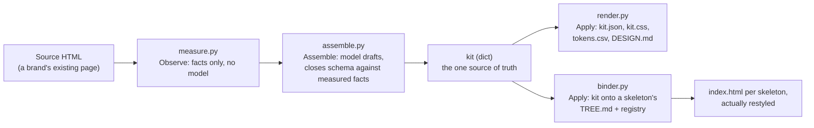
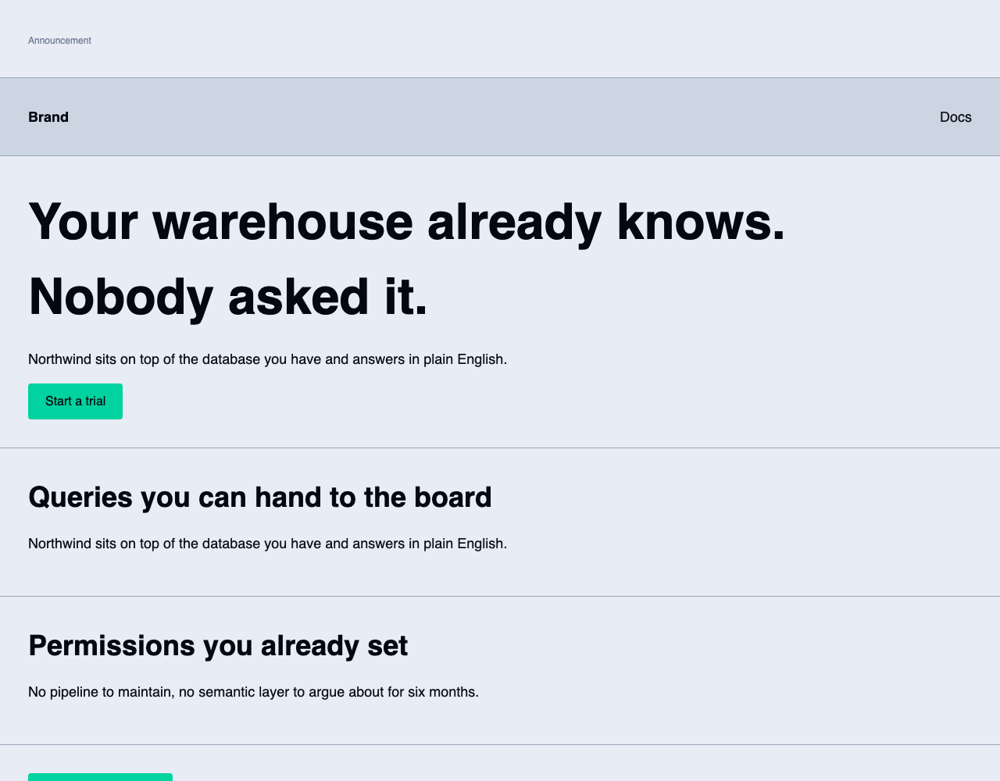

# brandkit

[](https://github.com/saadbutt/brandkit/actions/workflows/ci.yml)

Point it at a brand's existing page. It measures what is actually there, asks a
model to assign roles and write copy, and emits one kit that every artefact
reads: `kit.json`, `kit.css`, `tokens.csv`, a restyled `index.html` per
skeleton, and a `DESIGN.md` that cannot disagree with the stylesheet.

Two different models, same source, same kit, byte for byte.

```
$ python -m brandkit.cli verify examples/source-acme.html
Stub model (terse)       1c5f33e9343e0bac20a1ec280e6d0b170bb43e10c5bd663799377daf7efbbd6f
Stub model (verbose)     1c5f33e9343e0bac20a1ec280e6d0b170bb43e10c5bd663799377daf7efbbd6f
identical
```

Python 3.9 or newer. No dependencies, not even for the tests.

## Tech stack

- **Language:** Python 3.9–3.13, no dependencies, not even for the tests
- **Model interface:** one `Protocol` (`ModelAdapter`); two offline stubs for
  the test suite, one real OpenAI-compatible adapter via stdlib `urllib`
- **CI:** GitHub Actions — ruff, the full suite across all five supported
  Python versions, the determinism check, and the reproducible-build check

## Measurable results

- **106 tests**, no dependencies, under a second — see [Tests](#tests)
- **0 lint findings** — `ruff check .`
- **Byte-identical kits across models**, verified above and asserted in CI
  on every example source, not just the one shown
- **Invented values never land**: a stub model that tries to inject an
  unmeasured hex, typeface, size, radius and spacing value is in the suite,
  and `test_assemble.py` asserts none of it reaches the kit

## Architecture



Nothing downstream reads another artefact. `DESIGN.md` is rendered from the
kit, not parsed back from `kit.css`, so the two cannot drift against each
other — they're two views of the same dict.

## Demo output



This is `examples/source-northwind.html` run through `build`, its skeleton
opened in a real browser — not a mockup. Until this pass it wasn't: the
skeletons had no CSS rules consuming the tokens `kit.css` writes to `:root`,
so every `build` output actually rendered as unstyled default HTML despite
the kit itself being computed correctly. Each of the three skeletons now
carries a small stylesheet (`[data-slot="..."]` selectors reading the same
`var(--paper)`, `var(--primary)`, etc. tokens) so what you see above is what
`build` actually produces, confirmed across all three skeletons before this
was committed.

## Run it

```
python -m brandkit.cli build examples/source-acme.html --out build
python -m brandkit.cli verify examples/source-acme.html
python -m unittest discover -s tests -t .
```

`build` writes `build/kit.json`, `build/kit.css`, `build/tokens.csv`, and for
each skeleton `build/<skeleton>/index.html` plus `build/<skeleton>/DESIGN.md`.
`verify` runs two different models over one source and exits non-zero if the
kits differ.

## Three stages

**Observe.** `measure.py` reads the source and returns facts: hexes with use
counts, font families actually referenced, `@font-face` entries, font sizes
attributed to the tags that declare them, radii, shadows, spacing, and the
visible text per tag. No model is consulted. Same bytes in, same `Metrics` out.

**Assemble.** `assemble.py` holds the only function that writes a kit. The
model's answer is a *draft*: a proposal that must survive a closed schema and
then lose every argument it has with a measured fact.

**Apply.** `render.py` and `binder.py` read the kit. Nothing downstream reads
the draft, and nothing downstream writes to the kit. `kit.css`, `kit.json`,
`tokens.csv` and `DESIGN.md` are four views of one dict, which is the whole
reason the markdown cannot claim a hex that never reached `:root`. `DESIGN.md`
is never parsed back onto HTML.

## Why two models land on the same kit

The first version of the determinism test failed. Both stub models produced
valid, sensible, different kits, because both were allowed to pick which
measured hex became `primary`.

The fix was to take the vote away. Role assignment is now a pure function of
the measurements:

- `canvas` is the lightest measured colour, `ink` the darkest, ordered by
  `(luminance, hex)` so ties never fall back to dict order.
- `primary` is the most saturated colour that is neither paper nor ink.
- `on-primary` is whichever of paper or ink contrasts with `primary`.
- the neutral ramp is sampled from the remaining colours by luminance position.
- `display`, `heading-md` and `body` are anchored to the `h1`, `h2` and `p`
  rules the source declares. The rest fill from the sizes above and below body.
- `radius` is the smallest and largest measured radius.

A hex, typeface, size, radius or spacing value the source never used cannot
reach the kit, whatever the model asserts. `models/stub.py` has two models that
try: one invents `#7b3fe4`, Comic Sans, a 9999px step, a 42px radius and
`1000rem` spacing. None of it lands, and `tests/test_assemble.py` says so.

Copy is the one thing a model is allowed to write, so copy is deliberately
outside the fingerprint. Two models writing different words for the same brand
is not drift. Two models producing different hexes is.

### Where fewer sizes exist than steps

Assigning the type scale by position is the obvious implementation and it is
wrong. A page declaring `56px / 32px / 17px / 15px / 13px / 12px` has a 17px
body, not a 13px one, and position says 13px because 13 is the fifth largest
number in the stylesheet. So sizes are anchored to the markup that declares
them, and where the source has six sizes and the scale has eight steps, steps
repeat. A page with six sizes does not contain eight steps of information, and
repeating a measured size is honest in a way that interpolating a new one is
not.

## The registry is the contract

`registry.py` holds every block: its geometry, its required and optional slots,
and whether a tree may list it more than once. A skeleton's `TREE.md` may only
name ids that live there.

Adding a ninth page is one registry entry, not a template fork. Nothing in
`registry.py` knows about any particular skeleton, and nothing in `assemble.py`
knows about blocks at all.

`tests/test_new_block.py` is the test that holds that claim up. It registers a
new block, binds a new skeleton that uses it twice, and then asserts the
existing skeletons come out byte for byte identical and the kit's fingerprint
does not move. If adding a block ever requires editing `assemble.py`,
`render.py` or `binder.py`, that test is where it shows.

The binder paints theme and copy. It never moves or invents a band: band order
and count are checked against `TREE.md` and the registry before anything is
written, and an id in the markup that the tree never declared is rejected as
drift rather than accommodated.

## Swapping the model

`models/base.py` is the whole boundary:

```python
class ModelAdapter(Protocol):
    id: str
    label: str
    provider: str

    def draft(self, metrics_json: str) -> Draft: ...
```

`models/openai_compat.py` is a real adapter for any OpenAI-compatible endpoint,
stdlib `urllib`, temperature 0, `response_format: json_object`. It is not
exercised by the suite, because a test that needs a network and an API key is a
test that stops running. The two offline stubs cover the contract instead, and
if a live provider ever produces a different fingerprint the gap is in
`assemble.py`, not in the prompt.

## Tests

106 tests, no dependencies, about a second.

| file | what it holds up |
| --- | --- |
| `test_measure.py` | real sources yield real facts, and sizes attach to the tags that declare them |
| `test_schema.py` | a draft that invents a key is rejected, not quietly trimmed |
| `test_assemble.py` | invented hexes, typefaces, sizes, radii and spacing never land |
| `test_determinism.py` | two disagreeing models, one kit, on every source |
| `test_binder.py` | layout survives, theme and copy change, copy is escaped |
| `test_design_matches_css.py` | `DESIGN.md` is parsed back and compared to `:root` |
| `test_new_block.py` | a new block binds and the existing skeletons do not move |
| `test_cli.py` | end to end through the entry point a reviewer would run |

`test_assemble.py` pins a fingerprint on purpose. If measurement or role
assignment changes, it fails, and that failure is the point: it already caught
the type scale fix in this repo.

Three example sources, three brands that look nothing alike:

| source | fingerprint |
| --- | --- |
| `source-acme.html` | `1c5f33e9` |
| `source-northwind.html` | `a9f0f8cc` |
| `source-salt.html` | `d3017eb6` |

Different sources producing different kits is asserted too, because a pipeline
that emits a constant would otherwise pass every determinism test in the file.

## Layout

```
brandkit/
  measure.py        observe: facts from the source
  schema.py         the closed schema the model must answer in
  assemble.py       the only writer of a kit
  render.py         kit.json, kit.css, tokens.csv, DESIGN.md
  binder.py         TREE.md -> registry check -> painted HTML
  registry.py       the block contract
  cli.py            build, verify
  models/           base protocol, two offline stubs, one real adapter
examples/           three source pages
skeletons/          layout-base.html + TREE.md per page
tests/
```

`tokens.csv` comes out in Frappe Token Manager shape (`type,name,value` with
`Color` and `Font` rows), so the colours can be imported without a conversion
step.

## License

MIT.
